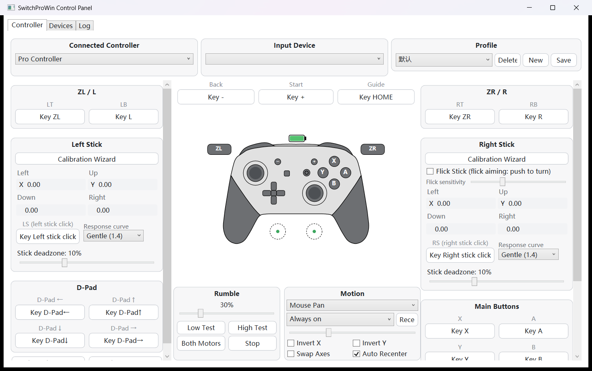
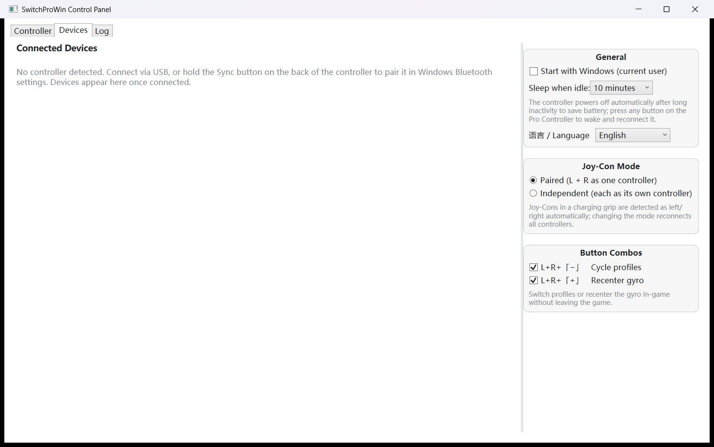

<div align="center">

# SwitchProWin

Windows driver and control panel for the Nintendo Switch Pro controller — connect over **USB / Bluetooth**,
map it to a **virtual Xbox 360 controller**, and play any Windows game with gamepad support (XInput / DirectInput).

`USB / Bluetooth` · `Joy-Con` · `Gyro Aiming` · `Flick Stick` · `Multiple Profiles` · `English / 中文`

[中文说明](README.md)

</div>

---

## Screenshots

| Controller tab | Devices tab |
|---|---|
|  |  |

## Table of Contents

- [Screenshots](#screenshots)
- [Features](#features)
- [Installation](#installation)
- [Quick Start](#quick-start)
- [Usage](#usage)
- [Building from Source](#building-from-source)
- [Project Structure](#project-structure)
- [Development & Testing](#development--testing)
- [Roadmap](#roadmap)
- [Contributing](#contributing)
- [License](#license)
- [Acknowledgements](#acknowledgements)

## Features

### Connection & Virtual Pad

- Bluetooth / USB connection, hot-plug, instant reconnect, automatic SPI stick factory calibration reading
- **Joy-Con support**: paired mode (L+R merged into one virtual pad, gyro from L, rumble sent to both),
  independent mode, charging grip auto-detection (L/R via SPI device type); one-click switching on the Devices tab
- Virtual Xbox 360 controller (ViGEmBus), verified end-to-end and in real games (including anti-cheat titles)
- **Rumble feedback**: official encoding algorithm + heartbeat + connect confirmation pulse,
  strength slider (with safety ceiling) + four test buttons
- **HidHide double-input prevention**: auto-configured when the driver is present (whitelist this app +
  hide physical devices), so games no longer "see two controllers"

### Motion (Gyro)

- Right-stick aiming (accumulate + decay) / mouse panning (SendInput) modes
- Activation button: hold ZL / ZR / L / R / stick / HOME, or always on
- Drift compensation: startup still calibration + auto recenter after 3 s idle + manual "Recenter" button
  (also L+R+「+」 in-game)
- **Flick Stick**: right stick direction = turn (flick toward the direction, keep rotating while held,
  small flicks for direction changes), adjustable sensitivity, stacks with gyro aiming
- Sensitivity 10%–300%, invert X/Y, swap axes

### Profiles

- Multiple profiles: save / new / delete / switch, JSON import & export
- **Per-game auto switching**: bind process names, the matching profile activates automatically in the foreground
- **Button combos**: L+R+「−」cycle profiles, L+R+「+」recenter gyro (toggleable on the Devices tab, no need to leave the game)
- 17-slot click-to-capture remapping + right-click "Turbo" (~10 Hz)
- Nintendo / Xbox layout one-click presets; stick deadzone / response curve (5 curves); software calibration overrides
- Stick calibration wizard: two steps (capture center + full range), one-click restore to factory calibration

### UI & Operations

- Eden-style light theme: vectorized live controller view (red highlight on press + trigger sink animation),
  adaptive three-column layout
- **UI language**: 中文 / English, follows the system language by default, switchable on the Devices tab,
  takes effect after restart (logs and the installer are bilingual too)
- Log tab (timestamps + history replay) + file log `%APPDATA%\SwitchProWin\log.txt`
- Low-battery tray notification (≤1/8 while not charging); idle auto-sleep (0–60 minutes, any button wakes it)
- Performance stats: report rate Hz + processing time (live on the Devices tab); zero allocation on hot paths
- Tray resident, single instance, start with Windows; friendly ViGEmBus-missing guidance
- Bilingual Inno Setup installer (auto-detects dependencies and guides the download)

## Installation

**Option 1: Installer** (recommended for most users)

1. Install the [ViGEmBus driver](https://github.com/nefarius/ViGEmBus/releases) (kernel driver for the virtual
   controller, required; the installer also detects and guides it)
2. Run `SwitchProWin-Setup-*.exe` (bilingual, follows the system language), with optional desktop shortcut
   and start-with-Windows
3. [HidHide](https://github.com/nefarius/HidHide/releases) is recommended (prevents double input; the installer guides it)

**Option 2: Run from source**: see [Building from Source](#building-from-source).

## Quick Start

1. Launch SwitchProWin (tray resident, the control panel opens automatically)
2. Connect the controller:
   - **USB**: plug in
   - **Bluetooth**: hold the Sync button on the back and pair in Windows Bluetooth settings
3. A "double short pulse" confirms the connection; the window shows battery and raw stick values live
4. Play any game with gamepad support

> ⚠️ For Steam games, disable "Steam Input" to avoid double processing.
> ⚠️ Do not run the GUI and the CLI at the same time: two virtual controllers would exist at once and
> game input would double up.

## Usage

### Graphical Control Panel

| Tab | Content |
|---|---|
| **Controller** | Top bar: input device & profile selection; left column button mapping / stick deadzone & curve / D-pad; middle column live controller view + rumble + motion; right column right stick / Flick Stick / per-game auto switch / profile import & export |
| **Devices** | Connected device cards (battery / connection / calibration / performance); global settings on the right: start with Windows, idle sleep, UI language, Joy-Con mode, combo toggles |
| **Log** | Live engine log (with history replay), clearable |

**Language switching**: Devices tab → General → 「语言 / Language」→ pick one and restart to apply
(the app offers an immediate restart).

### Verification Console (SwitchProWinCli)

```bash
dotnet run --project src/SwitchProWin.Cli -c Release
```

| Key | Action |
|---|---|
| `1` | Low-frequency motor (XInput LargeMotor) rumble test |
| `2` | High-frequency motor (XInput SmallMotor) rumble test |
| `3` | Both motors |
| `0` | Stop rumble |
| `V` | Create a 3-second pure virtual pad (verifies ViGEmBus without a controller) |
| `Q` | Quit |

## Building from Source

**Requirements**

1. Windows 10/11 x64
2. [.NET 8 SDK](https://dotnet.microsoft.com/download/dotnet/8.0)
3. ViGEmBus driver (required at runtime): https://github.com/nefarius/ViGEmBus/releases

**Build & run**

```bash
dotnet build SwitchProWin.sln -c Release
dotnet test  SwitchProWin.sln            # protocol/mapping/config/localization unit tests

# Graphical control panel (tray resident, recommended for daily use)
start src/SwitchProWin.App/bin/Release/net8.0-windows/SwitchProWinApp.exe

# Verification console (no UI needed)
dotnet run --project src/SwitchProWin.Cli -c Release
```

> ⚠️ Exit any running instance (GUI: right-click the tray icon → Exit; CLI: press Q) before rebuilding,
> otherwise the old process locks the DLLs and the build fails.

**Building the installer**: `dotnet publish -c Release -r win-x64 --self-contained false -o publish`, then
place the publish output next to `installer/setup.iss` and compile with ISCC.exe (Inno Setup 6.3+ bundles
the Chinese language file).

## Project Structure

```
src/
├─ SwitchProWin.Protocol/   # Protocol library: 0x30/0x21/0x3F parsing, subcommand/rumble packet building, SPI calibration decoding
├─ SwitchProWin.Mapper/     # Mapping engine: configurable button map (Pro → Xbox360), deadzone/curve/radial processing, Flick Stick
├─ SwitchProWin.ViGEm/      # ViGEmBus client wrapper (virtual X360 pad lifecycle)
├─ SwitchProWin.Engine/     # Device management (hot-plug), sessions, AppConfig/ControllerProfile, engine orchestration, localization (zh/en)
├─ SwitchProWin.App/        # WPF control panel: Eden-style config tab (vector controller/slot capture), devices, log
└─ SwitchProWin.Cli/        # Verification console
tests/
└─ SwitchProWin.Tests/      # Report golden-sample tests + config/localization regression tests
installer/
└─ setup.iss                # Bilingual Inno Setup script
```

## Development & Testing

- **83 unit tests** all passing: protocol golden samples (0x30 report verified byte by byte), mapping/calibration,
  gyro, Flick Stick, rumble encoding, config round-trips, localization (key parity / language switching / fallback)
- End-to-end verification: winmm probe, 130 input transitions all passing; tested in real games (including anti-cheat)
- Performance goals: zero allocation on hot paths, live report-rate and processing-time stats

Developer verification steps (confirm the driver pipeline works):

1. Run the CLI, connect the controller, and check the log for:
   - `输入模式 -> 0x30: ACK` and three more ACK lines (input mode / IMU / rumble / player LED)
   - `摇杆校准 OK L[cx=...] R[cx=...]`
   - `虚拟 Xbox 360 手柄已创建`
2. `Win+R` → `joy.cpl`: a "Controller (XBOX 360 For Windows)" appears; its number highlights on button presses
3. Move the physical left stick, open the virtual pad in joy.cpl → Properties, and watch the axes move

(Log messages follow the configured UI language — an English install prints the equivalent English lines.)

## Roadmap

- [x] Core: connection / virtual pad / rumble / button mapping / stick processing (v1.0)
- [x] Joy-Con, Flick Stick, button combos, calibration wizard, per-game switching (v1.1)
- [x] Bilingual UI (English / 中文) and installer
- [ ] First-run wizard (one-click ViGEmBus install + pairing guide)
- [ ] CI (GitHub Actions)
- [ ] Automatic update checks
- [ ] Input overlay, latency graph, virtual DS4

## Contributing

Issues and PRs are welcome:

1. Fork → feature branch → changes with tests → `dotnet test` green → open a PR
2. Commit messages should follow conventional prefixes (`feat:` / `fix:` / `docs:` / `refactor:` / `test:`)
3. For protocol or concurrency changes (read thread / merger), describe how you verified them

## License

- This project is released under **GPL-3.0**: the controller outline data in
  `src/SwitchProWin.App/Controls/ProControllerShape.cs` comes from the Eden emulator (GPL-3.0), so releases must
  use GPL-3.0 (or a compatible license) and keep the attribution in that file's header.
- The protocol implementation is original (based on public protocol documentation); no code was copied from
  GPL projects such as BetterJoy.
- For use with controllers you personally own; the software name and icons must not use Nintendo trademarks.

## Acknowledgements

- [Eden emulator](https://eden-emu.dev/) — controller outline data & UI style reference (GPL-3.0)
- [dekuNukem/Nintendo_Switch_Reverse_Engineering](https://github.com/dekuNukem/Nintendo_Switch_Reverse_Engineering) — protocol documentation
- [Linux hid-nintendo driver](https://docs.kernel.org/hid/hid-nintendo.html) — protocol reference
- [ViGEmBus](https://github.com/nefarius/ViGEmBus) / [ViGEm.Client](https://www.nuget.org/packages/Nefarius.ViGEm.Client) — virtual controller driver
- [HidHide](https://github.com/nefarius/HidHide) — double-input prevention
